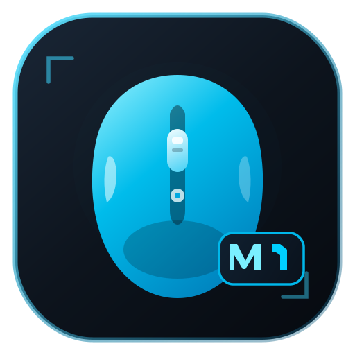
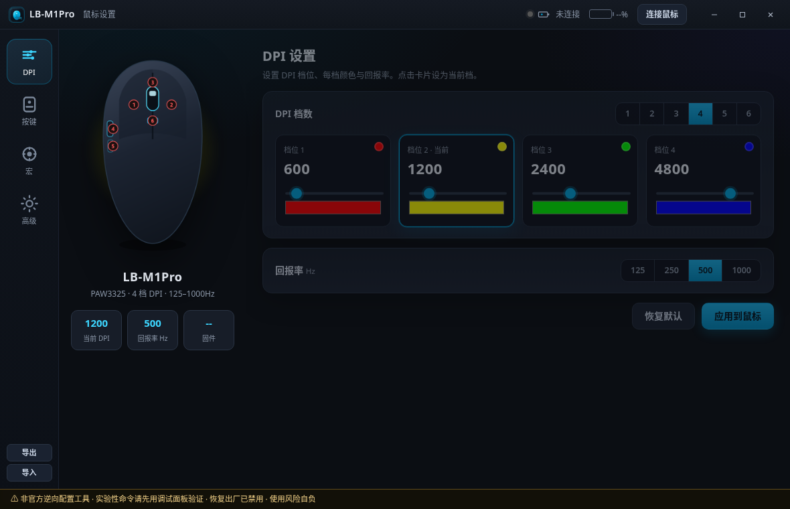

# LB-M1Pro 鼠标设置（非官方）

<p align="center">
  
</p>

<p align="center">
  <b>Windows 第三方配置工具</b> · Electron + WebHID · 简体中文<br>
  面向 LB-M1Pro 无线/有线游戏鼠标（VID <code>088D</code> / PID <code>052E</code>·<code>052F</code>）
</p>

<p align="center">
  
</p>

> **免责声明 / 风险自负**  
> 本项目为对官方驱动 `CBMouse.exe` 的**静态逆向**实现，**与厂商无关、非官方**。  
> 协议细节除文档标注「已确认」外均属实验性。错误写入可能导致异常配置。  
> **禁止固件升级 / 恢复出厂** 类危险命令已在程序中屏蔽。使用本软件即表示你自行承担一切风险。

## 功能

| 模块 | 说明 |
|------|------|
| **DPI** | 1–6 档、每档颜色、回报率 125/250/500/1000 Hz |
| **按键** | 6 键重映射：鼠标 / DPI / 灯光快捷键 / 多媒体 / 键盘组合 / 宏 |
| **宏** | 录制键盘鼠标动作，写入设备最多 10 个缓冲区（实验性） |
| **高级** | LOD、休眠、移动关灯、唤醒、纹波、角度捕捉、动作同步、高性能（实验性） |
| **调试** | 原始 Feature Report 收发日志 |
| **持久化** | 所有设置与窗口位置自动保存到 Electron `userData`；连接后自动应用一次 |
| **导入/导出** | JSON 配置文件 |

> 官方驱动对本机 `ShowLED=0`，本工具**不提供灯光配置页**。

## 下载

到 [Releases](https://github.com/cnsunsz/LB-M1Pro-Config/releases) 下载：

- `LB-M1Pro-Config-v0.2.0.exe` — 单文件便携版（约 63 MiB，无需安装）

首次启动会自解压，可能稍慢。程序**未签名**，SmartScreen 可能提示「未知发布者」，请选择仍要运行。

## 使用

1. 插入鼠标（USB 或 2.4G 接收器）
2. 运行 exe，点击右上角 **连接鼠标**，允许 HID
3. 建议先打开「高级 → 原始 HID 调试面板」→ **读设备信息**，确认 Identify / 电量
4. 修改设置会自动保存；也可点「应用到鼠标」立即写入

## 从源码构建

环境：Node.js 20+、Linux/macOS/Windows；在 Linux 上打 Windows 包需 Wine。

```bash
cd app
npm install
npm run dist
# 产物：../dist-build/LB-M1Pro-Config.exe
```

## 协议说明

详见 [PROTOCOL.md](./PROTOCOL.md)。摘要：

- HID Feature Report ID **`0x0F`**，33 字节帧（CDevSprime）
- 命令含 DPI `0x05`、回报率 `0x07`、按键 `0x04`、读信息 `0x30` 等

## 图标

原创 SVG：`app/build/logo.svg` / `assets/logo.svg`（深色底板 + 青色鼠标剪影 + M1 徽标）。  
界面中的鼠标示意图亦为原创 SVG，**不包含**官方驱动素材。

## License

[MIT](./LICENSE)
